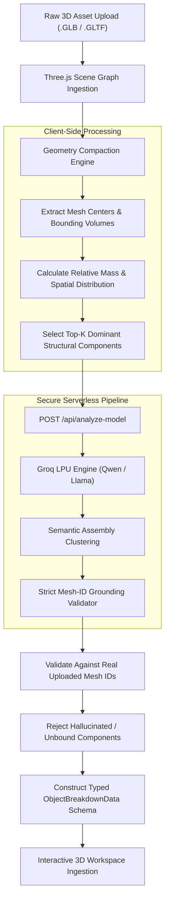
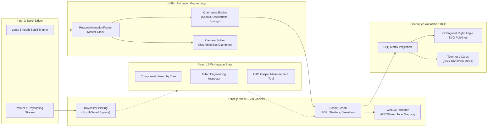

# OBJECT // BREAKDOWN

<div align="center">

<h3>Deconstruct the Invisible — Interactive 3D Reverse-Engineering & Spatial Kinematics Platform</h3>

<p>
  <strong>Explore how complex physical products are engineered — component by component, material by material, kinematic cycle by kinematic cycle.</strong>
</p>

[](https://object-breakdown.vercel.app/)
[](https://react.dev/)
[](https://threejs.org/)
[](https://www.typescriptlang.org/)
[](https://vite.dev/)

[](https://tailwindcss.com/)
[](https://lenis.darkroom.engineering/)
[](https://motion.dev/)
[](https://lucide.dev/)

[](https://groq.com/)
[](https://huggingface.co/Qwen)
[](https://vercel.com/)
[](https://oxc.rs/)

<br />

[**Explore Live Demo**](https://object-breakdown.vercel.app/) • [**Key Features**](#-key-features) • [**Specimen Library**](#-curated-specimen-library) • [**AI Deconstruction Pipeline**](#-ai-semantic-reverse-engineering-pipeline) • [**Architecture**](#-system-architecture) • [**Getting Started**](#-getting-started) • [**Roadmap**](#-roadmap)

</div>

---

## 📌 Overview: The "Black Box" Problem

Modern industrial design hermetically seals products into sleek, seamless enclosures. From aerospace turbofans and mechanical watch calibres to autonomous drones and everyday consumer items, the internal engineering that makes physical technology work remains hidden from students, designers, and enthusiasts.

Existing tools fail to bridge this divide:
- **Workstation CAD Packages** (CATIA, SolidWorks, Siemens NX) require expensive multi-gigabyte licenses, steep learning curves, and dedicated GPU workstations.
- **Traditional 3D Web Viewers** display static polygon meshes with arbitrary fragment IDs (`Object_12`, `Mesh_47`), offering zero insight into *why* a part exists, what alloy it is forged from, or how it interfaces with neighboring components.
- **2D Textbooks & Manuals** detach mechanical kinematics from real-time motion and spatial intuition.

**OBJECT // BREAKDOWN** transforms CAD models and 3D assets into an interactive, browser-native reverse-engineering workstation. It couples **144 Hz real-time WebGL kinematics**, **sub-micron material telemetry**, and an **anti-hallucination AI deconstruction pipeline** that turns arbitrary 3D geometry into structured engineering intelligence.

---

## ✨ Key Features

### 1. Scroll-Driven Kinematic Storytelling
- **Sub-Pixel Scroll Interpolation**: Powered by a custom Lenis physics driver synchronized with Three.js camera rigs.
- **Live Kinetic Simulation**: Balance wheels oscillate at authentic horological frequencies (4 Hz / 28,800 vph), turbofan low- and high-pressure spools rotate at differential velocities, and return springs compress dynamically.
- **Coaxial & Radial Blooms**: Assemblies blossom organically from assembled production states into deconstructed engineering stages.

### 2. Comprehensive 3D Engineering Workspace
- **Progressive Multi-Axial Explosion**: Continuous slider control lets you deconstruct assemblies layer by layer along calculated explosion vectors.
- **Component Tree Hierarchy**: Isolate, highlight, or hide specific sub-assemblies, structural bulkheads, or internal fasteners.
- **Sub-Millimeter CAD Caliper Tool**: Click any two vertices or surfaces on live 3D geometry to measure true distance, spatial delta ($\Delta X, \Delta Y, \Delta Z$), and evaluate manufacturing clearance.
- **Deterministic Orthogonal Leader-Lines**: Direct DOM annotation engine that bypasses React reconciliation to render rock-solid, anti-flicker SVG callout vectors at 144 Hz without UI obstruction.

### 3. Specialized Visualization Modes

Switch between 6 distinct diagnostic rendering modes designed to simulate professional CAD and CAE environments:

| Mode | Visual Engine | Engineering Purpose |
|:---|:---|:---|
| **Solid** | Physical PBR Shading | Photorealistic materials, roughness, metalness, and studio lighting rigs. |
| **X-Ray / Ghost** | Fresnel Translucency | Reveals internal mechanisms, cavities, bearings, and nested shafts. |
| **Wireframe** | Polygon Topology | Inspects mesh density, polygon distribution, and CAD tessellation structure. |
| **CAD Section** | Orthogonal Clipping Planes | Cuts clean geometric cross-sections through solid housings. |
| **Stress / FEA** | Thermal-Gradient Shader | Approximates finite element stress concentrations under operating loads. |
| **Thermal / CFD** | Enthalpy Flow Shader | Visualizes heat dissipation gradients and aerodynamic thermal boundaries. |

### 4. Deep Engineering Intelligence Panel
Every component is mapped to an aerospace-grade technical dossier across 9 analytical views:

- 🔬 **Material Science & Metrology**: Exact alloy grades (e.g., Inconel 713C, Ti-6Al-4V Grade 5, Glucydur, Nivarox, AISI 316L, ASTM A228), tensile/yield strength, hardness (Rockwell/Vickers), density, and tribological properties.
- ⚙️ **Manufacturing Telemetry**: Primary processes (Swiss screw turning, 5-axis CNC, investment casting, deep drawing, metal injection molding), machinery, dimensional tolerances ($\pm \mu\text{m}$), and defect risks.
- 🛡️ **Failure Mode & Effects Analysis (FMEA)**: Critical failure mechanisms (fatigue cracking, creep, fretting wear, cavitation, thermal shock), root causes, inspection intervals, and preventative mitigations.
- 📐 **Kinematic Breakdown & Equations**: Step-by-step mechanical cycle breakdowns paired with interactive mathematical calculators (e.g., turbine pressure ratios, balance wheel harmonics, boost pressure enthalpy).
- 🧪 **What-If Engineering Simulator**: Real-time parametric slider simulations (e.g., change rotor RPM, ambient temperature, or material alloys to evaluate simulated safety factor shifts).
- 💬 **Ask the Engineer**: In-context conversational AI trained on mechanical engineering principles to answer specific questions regarding component trade-offs.

---

## 🏛️ Curated Specimen Library

The platform ships with a preloaded library of hand-engineered specimens deconstructed down to their individual fasteners, bearings, and alloys:

```
┌─────────────────────────────────────────────────────────────────────────────┐
│                          FLAGSHIP SPECIMEN MATRIX                           │
├──────────────────────────┬──────────────────────┬───────────────────────────┤
│ Specimen                 │ Engineering Domain   │ Highlight Components      │
├──────────────────────────┼──────────────────────┼───────────────────────────┤
│ High-Bypass Turbofan     │ Aerospace & Aero-    │ • Hollow Ti-6Al-4V Fan    │
│ Commercial Jet Engine    │ thermodynamics       │ • 42:1 HP Compressor      │
│                          │                      │ • CMSX-4 Single-Crystal   │
│                          │                      │   HP Turbine Vanes        │
├──────────────────────────┼──────────────────────┼───────────────────────────┤
│ Swiss Mechanical Calibre │ Horology & Harmonic  │ • 4 Hz Glucydur Balance   │
│ Automatic Wristwatch     │ Micro-Mechanics      │ • Nivarox Hairspring      │
│                          │                      │ • Synthetic Ruby Pallets  │
├──────────────────────────┼──────────────────────┼───────────────────────────┤
│ Autonomous Aerial Drone  │ Avionics, Robotics & │ • GPU Skeletal Bones      │
│ Carbon Quadcopter        │ GPU Skinned Rigs     │ • Brushless Outrunners    │
│                          │                      │ • 3-Axis Gimbal IMU       │
├──────────────────────────┼──────────────────────┼───────────────────────────┤
│ Twin-Scroll Turbocharger │ Automotive Powertrain│ • Inconel 713C Turbine    │
│ Forced Induction System  │ & Rotordynamics      │ • 220,000 RPM CHRA Shaft  │
│                          │                      │ • Pneumatic Wastegate Arm │
├──────────────────────────┼──────────────────────┼───────────────────────────┤
│ Retractable Ballpoint    │ Micro-Fluidics &     │ • 1.0mm Tungsten Carbide  │
│ Precision Mechanism      │ High-Volume Mfg      │ • Free-Cutting Brass Tip  │
│                          │                      │ • ASTM A228 Helical Spring│
├──────────────────────────┼──────────────────────┼───────────────────────────┤
│ Industrial Motor         │ Electromechanical &  │ • Laminated Silicon Stator│
│ AC Induction Drive       │ Electromagnetic Flux │ • Squirrel-Cage Rotor     │
│                          │                      │ • Deep-Groove Ball Bearings│
├──────────────────────────┼──────────────────────┼───────────────────────────┤
│ Mechanical Keyboard      │ Human-Machine Inter- │ • Gasket-Mounted FR4 Plate│
│ Custom Tactile Chassis   │ face & Acoustic CAD  │ • Polycarbonate Switch Pod│
│                          │                      │ • Hot-Swap PCB Matrix     │
└──────────────────────────┴──────────────────────┴───────────────────────────┘
```

---

## 🧠 AI Semantic Reverse-Engineering Pipeline

Raw 3D files (`.glb` / `.gltf`) uploaded by users are typically disorganized hierarchies of arbitrary meshes (`Object_34`, `Mesh_002`, `Part_A`). 

OBJECT // BREAKDOWN implements a server-side AI pipeline powered by **Groq LPU Inference** (`qwen/qwen3.8-27b`) that transforms raw geometry into grounded mechanical components with zero manual tagging:



### Strict Grounding & Anti-Hallucination Design
> [!IMPORTANT]
> A core engineering design constraint of the pipeline is that **LLM output is strictly grounded in physical asset geometry**:
> 1. Every synthesized component **must** map directly to valid, verifiable mesh IDs extracted from the uploaded file.
> 2. Generic placeholder names (`Detected Part 4`, `Spatial Group B`) are explicitly penalized and rejected by the validator.
> 3. If geometric evidence is insufficient to identify a component with certainty, the system assigns explicit confidence ratings rather than fabricating claims.

### Telemetry Confidence Ratings
Every AI-generated claim is tagged with an epistemic confidence rating:

| Rating | Definition | Example Application |
|:---|:---|:---|
| `Verified` | Confirmed by explicit CAD metadata, name strings, or undeniable geometry. | Symmetrical turbine fan blades on a rotating shaft. |
| `Typical` | Standard engineering industry practice for this specific mechanical function. | 316L stainless steel for an exterior water-resistant casing. |
| `Estimated` | Inferred from component aspect ratio, wall thickness, and neighbor relations. | Injection-molded ABS for internal structural brackets. |
| `Model-dependent` | Variable depending on the specific manufacturer or price tier. | Ceramic vs. steel ball bearings in an automotive turbocharger. |
| `Unknown` | Insufficient geometric evidence to declare composition without disassembly. | Internal microchip composition on an un-textured PCB surface. |

---

## 🏗️ System Architecture

The application is structured to ensure high-frequency frame stability (60–144 Hz) while managing heavy 3D CAD assets and complex UI overlays:



### Architectural Highlights
- **Direct DOM Annotation Layer**: Leader-line coordinates and card positions bypass React state re-renders entirely during camera translation and scrolling, executing directly against SVG path attributes and CSS transform matrices at 144 Hz.
- **Scroll-Gated Raycasting**: Expensive ray-triangle intersection tests are paused while the user is actively scrolling, preventing main-thread CPU spikes and guaranteeing stutter-free frame delivery.
- **O(1) Bounding Projections**: Component centers are cached during model ingestion, eliminating repeated runtime CPU vertex buffer traversals (`Box3.setFromObject`).

---

## 🛠️ Technology Stack

```
Frontend Architecture
  ├── Core Framework:       React 19.2 (Concurrent Mode)
  ├── Language:             TypeScript 6.0 (Strict Typing)
  ├── 3D Engine:            Three.js r185 (WebGL 2.0 / PBR / GLTF Loader)
  ├── Styling & Design:     Tailwind CSS v4.0 + Lucide React
  ├── Motion & Physics:     Lenis Scroll Engine + Framer Motion
  └── Build Tooling:        Vite 8.2 + Oxlint

Backend & AI Inference
  ├── Serverless API:       Node.js ES Modules (/api/analyze-model.mjs)
  ├── Local Dev Server:     Node.js Native HTTP Proxy (server.mjs)
  ├── AI Acceleration:      Groq LPU (Language Processing Unit)
  └── Inferred Model:       qwen/qwen3.8-27b (via Groq Cloud API)

Deployment & Infrastructure
  ├── Production Host:      Vercel (Edge Network + Serverless Functions)
  └── Asset Delivery:       Draco-Compressed GLTF / GLB Binaries
```

---

## 🚀 Getting Started

### Prerequisites
- **Node.js**: `v20.0.0` or higher
- **Package Manager**: `npm` (comes with Node.js)
- **Groq API Key**: Obtain a free API key from [Groq Console](https://console.groq.com/) for the model upload feature.

### 1. Clone the Repository
```bash
git clone https://github.com/anshbhatt944-debug/object-breakdown.git
cd object-breakdown
```

### 2. Install Dependencies
```bash
npm install
```

### 3. Configure Environment Variables
Create a `.env` file in the project root:

```env
# Groq API Key for AI Model Upload Breakdown
GROQ_API_KEY=gsk_your_actual_groq_api_key_here

# Groq Model Designation (Default: qwen/qwen3.8-27b)
GROQ_MODEL=qwen/qwen3.8-27b

# Local API Server Port (Default: 8787)
PORT=8787
```

> [!TIP]
> Never prefix your `GROQ_API_KEY` with `VITE_`. Keeping it private ensures your API credentials are never bundled into client-side JavaScript.

### 4. Run the Development Environment

Run both the local API server and the Vite dev server in separate terminal sessions:

**Terminal 1 (Local API Proxy):**
```bash
npm run server
# Starts local API server on http://localhost:8787
```

**Terminal 2 (Frontend Client):**
```bash
npm run dev
# Starts Vite development server on http://localhost:5173
```

Open [http://localhost:5173](http://localhost:5173) in any WebGL2-compatible browser (Chrome, Edge, Firefox, Brave, Safari 16+).

### 5. Production Build & Linting

```bash
# Type check and build optimized static assets
npm run build

# Preview production build locally
npm run preview

# Run high-performance linter
npm run lint
```

---

## 🌐 Deploying to Vercel

The project is pre-configured for one-click deployment on [Vercel](https://vercel.com/):

1. Push your repository to GitHub or GitLab.
2. Import the project into your Vercel Dashboard.
3. Under **Project Settings → Environment Variables**, add:
   - `GROQ_API_KEY`: Your Groq API Key
   - `GROQ_MODEL`: `qwen/qwen3.8-27b` (Optional override)
4. Click **Deploy**. Vercel will automatically configure `/api/analyze-model` via `api/analyze-model.mjs`.

---

## 📁 Project Directory Structure

```text
object-breakdown/
├── api/
│   └── analyze-model.mjs        # Production Vercel serverless Groq endpoint
├── public/
│   └── models/                  # Curated 3D assets (.glb / .gltf)
├── src/
│   ├── assets/                  # Static brand assets and icons
│   ├── components/
│   │   ├── common/              # Shared UI: Cursors, Modals, Scan Overlays
│   │   ├── landing/             # 144Hz Scroll-driven cinematic landing page
│   │   │   ├── ImmersiveExperience.tsx  # Master 3D landing showcase
│   │   │   ├── Navbar.tsx               # Reactive chapter telemetry bar
│   │   │   └── PopularObjects.tsx       # Curated specimen launch cards
│   │   └── workspace/           # Interactive 3D reverse-engineering workspace
│   │       ├── inspector/       # 9 Engineering telemetry tabs (Materials, FMEA, etc.)
│   │       ├── viewer3d/        # Three.js canvas, caliper metrology, view modes
│   │       ├── ComponentTree.tsx        # CAD part hierarchy tree
│   │       ├── StatusBar.tsx            # Real-time WebGL performance metrics
│   │       └── WorkspaceLayout.tsx      # Main engineering workspace frame
│   ├── data/
│   │   ├── objects/             # Hand-curated engineering spec databases
│   │   ├── cadDimensionsDatabase.ts     # Metrology reference data
│   │   ├── objectRegistry.ts            # Central object catalog
│   │   └── uploadAnalysis.ts            # Client-side 3D geometry extraction
│   ├── types/
│   │   └── objectData.ts        # Comprehensive TypeScript engineering schema
│   ├── utils/
│   │   ├── annotationSolver.ts  # Orthogonal SVG leader-line routing solver
│   │   └── useDraggable.ts      # UI panel gesture controls
│   ├── App.tsx                  # Root application router & state manager
│   ├── index.css                # Carbon token design system
│   └── main.tsx                 # React DOM root entry
├── server.mjs                   # Local development API proxy server
├── vite.config.ts               # Vite bundler & API proxy configuration
├── vercel.json                  # Vercel deployment routing manifest
└── package.json                 # Project dependencies & scripts
```

---

## ⚖️ Engineering Integrity & Boundaries

OBJECT // BREAKDOWN is designed for **technical exploration, reverse-engineering education, and spatial learning**.

- **Not Certified for Production Sign-Off**: AI-derived material grades, manufacturing tolerances, and failure analysis reflect standard engineering practice and probabilistic inference—not manufacturer-certified drawings.
- **Physical Grounding**: Real engineering parameters (destructive tensile yield, internal micro-voids, exact heat treatment schedules) require physical destructive testing, CMM metrology, and official OEM datasheets.
- **Intellectual Property**: Curated specimens use publicly accessible or open-source CAD specimens modified for interactive educational deconstruction.

---

## 🗺️ Roadmap & Future Horizons

- [x] **Phase 1: Foundation & Kinematics** *(Completed)*
  - 7 flagship mechanical specimens with hand-crafted engineering data.
  - 144 Hz Lenis scroll engine with zero-re-render leader-line rendering.
  - 6 engineering visualization modes (Solid, X-Ray, Wireframe, CAD Section, Stress, Thermal).
  - Sub-millimeter interactive CAD calipers tool.
- [x] **Phase 2: Automated AI Ingestion** *(Completed)*
  - Drag-and-drop `.glb` / `.gltf` upload pipeline.
  - Server-side Groq LPU inference with strict mesh-ID grounding validation.
  - Multi-tier confidence telemetry scoring.
- [ ] **Phase 3: Real-Time WebGPU Physics** *(In Progress)*
  - WebGPU Compute Shaders for live Finite Element Stress Analysis (FEA).
  - Real-time Computational Fluid Dynamics (CFD) airflow particle ribbons.
- [ ] **Phase 4: Native CAD Formats & WebXR** *(Planned)*
  - Native client-side parsing for `.step`, `.stp`, `.iges`, and `.stl` files.
  - Automated Bill-of-Materials (BOM) export (`.csv` / `.json`).
  - Immersive spatial deconstruction for Apple Vision Pro & Meta Quest 3 headsets via WebXR.

---

## 🤝 Contributing

Contributions from mechanical engineers, materials scientists, 3D artists, and software developers are warmly welcomed!

1. **Fork the Repository**
2. **Create a Feature Branch**:
   ```bash
   git checkout -b feature/specimen-hydraulic-pump
   ```
3. **Commit Your Changes**:
   ```bash
   git commit -m "feat(specimen): add axial piston hydraulic pump engineering data"
   ```
4. **Push to the Branch**:
   ```bash
   git push origin feature/specimen-hydraulic-pump
   ```
5. **Open a Pull Request**

Please ensure your code passes linting (`npm run lint`) and TypeScript compilation (`npm run build`) before submitting.

---

<div align="center">

**Built for the curious, the builders, and the engineers.**

<p>
  <sub>Have a specimen or feature request? <a href="https://github.com/anshbhatt944-debug/object-breakdown/issues">Open an issue on GitHub</a>.</sub>
</p>

</div>
